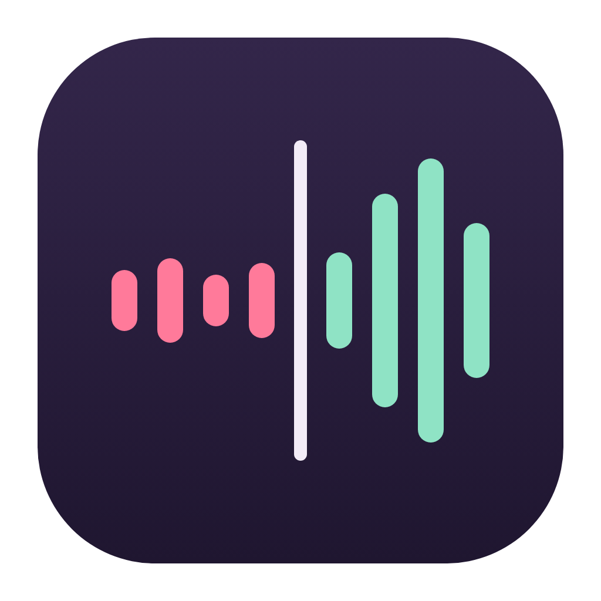
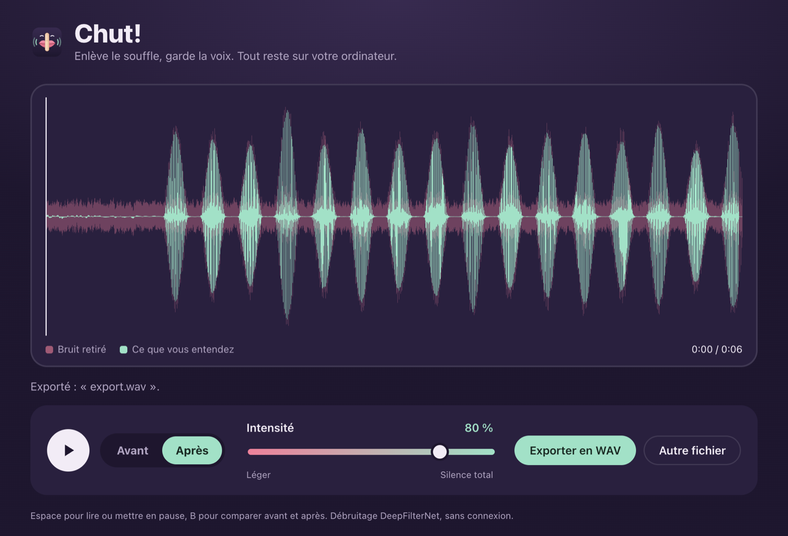

<p align="center"></p>

# Chut!

**[Page de téléchargement](https://cdriccarboni.github.io/chut/)** : macOS, Windows et Linux, avec une démo avant/après à écouter.

Chut! enlève le souffle, le ventilo et le bruit de fond de vos enregistrements de voix. C'est gratuit, ça marche sur Mac, Windows et Linux, et rien ne quitte votre ordinateur : pas de compte, pas d'envoi en ligne.

Sous le capot, c'est [DeepFilterNet](https://github.com/Rikorose/DeepFilterNet), un débruiteur libre par réseau de neurones, très efficace sur la voix.



## Télécharger

Le plus simple : la [page de Chut!](https://cdriccarboni.github.io/chut/), qui propose le bon fichier pour votre système. Sinon, tout est sur la [page des versions](https://github.com/cdriccarboni/chut/releases) :

| Système | Fichier |
|---|---|
| Mac Apple Silicon (M1, M2, M3…) | `Chut-…-mac-arm64.dmg` |
| Mac Intel | `Chut-…-mac-x64.dmg` |
| Windows (installateur) | `Chut-…-win-x64-setup.exe` |
| Windows (sans installation) | `Chut-…-win-x64-portable.exe` |
| Linux (toutes distributions) | `Chut-…-linux-x86_64.AppImage` |
| Debian, Ubuntu | `Chut-…-linux-amd64.deb` |

### Premier lancement

L'appli n'est pas signée par un certificat payant, donc le système va se méfier un peu la première fois.

- **macOS** : faites un clic droit sur Chut! dans Applications, puis **Ouvrir**, et confirmez. Si macOS refuse quand même (macOS 15 et plus), allez dans Réglages Système > Confidentialité et sécurité, puis cliquez sur **Ouvrir quand même** en bas de la page.
- **Windows** : si SmartScreen affiche « Windows a protégé votre ordinateur », cliquez sur **Informations complémentaires** puis **Exécuter quand même**.
- **Linux** : rendez l'AppImage exécutable (`chmod +x Chut-*.AppImage`). Si elle ne démarre pas sur Ubuntu 24.04 ou plus, préférez le paquet `.deb`.

## Comment ça marche

1. Glissez un fichier audio dans la fenêtre (WAV, MP3, FLAC, OGG ou M4A), ou cliquez sur « Essayer avec un exemple ».
2. Le débruitage se lance tout seul, en quelques secondes.
3. Écoutez, et passez d'**Avant** à **Après** à tout moment (touche B) : la bascule se fait sans coupure.
4. Réglez l'**intensité** pendant l'écoute : à gauche on garde un peu d'ambiance, à droite c'est le silence total entre les phrases.
5. **Exportez en WAV** (24 bits, 48 kHz).

## Pour les développeurs

Il faut Node.js 20 ou plus.

```sh
npm install
npm run fetch-engine   # télécharge le moteur DeepFilterNet et vérifie son empreinte SHA-256
npm start
```

| Commande | Rôle |
|---|---|
| `npm test` | Tests automatisés, dont un vrai débruitage d'un signal synthétique |
| `npm run test:e2e` | Lance l'appli complète en mode test et enregistre une capture dans `.smoke/` |
| `npm run icons` | Régénère les icônes depuis `build/icon.svg` (macOS) |
| `npm run dist:mac` / `dist:win` / `dist:linux` | Fabrique les paquets dans `dist/` |

Pousser un tag `v*` déclenche la fabrication sur macOS, Windows et Linux par GitHub Actions, et joint les fichiers à la version correspondante.

Le choix du moteur et la comparaison avec les autres briques libres sont expliqués dans [docs/ANALYSE.md](docs/ANALYSE.md).

## Licences

Chut! est sous licence [MIT](LICENSE). DeepFilterNet est sous licence MIT ou Apache-2.0 ; le détail des composants tiers est dans [THIRD_PARTY_LICENSES.md](THIRD_PARTY_LICENSES.md).
